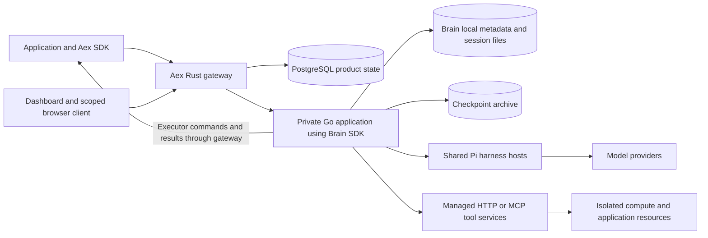

# ADR 011 Aex integration with Brain 2.0

Status: **Accepted; implemented in the Brain 2.1 integration**, 2026-10-20. Production cutover and publication evidence are linked from the [roadmap](../../ROADMAP.md). The source-baseline tables below describe the pre-migration inspection.

## Integration prerequisites selected on 2026-10-19

[Brain ADR 0004](https://github.com/aexhq/brain/blob/main/docs/adr/0004-service-integration-readiness.md)
and [plan 12](https://github.com/aexhq/brain/blob/main/docs/plans/12-service-integration-readiness.md)
own the neutral prerequisites before Aex or other services cut over. The source-baseline tables
below still describe the inspected implementation; they are not the selected final scope.

- Support Pi, Codex and OpenCode through the common contract before dependent-service adoption.
- Retain shared native harness servers and existing per-host caps. A common host pool adds
  optional controls across servers, with no extra utilization limit by default. Session
  isolation remains an adapter requirement; per-session containers are not selected.
- Support model and tool credentials at server startup and through authorized clients. Tools
  can be declared on the server or client; client functions stay in their declaring process.
- Expose tool/model authoring helpers so ordinary SDK consumers do not construct bindings,
  executors or command frames. Those remain documented low-level wire concepts.
- Support both attached-tab tools and a separate managed remote-browser integration. The
  first browser transport is a same-origin platform gateway with streaming fetch and SSE/HTTP
  callbacks; direct CORS and browser RPC are follow-ups with separate authorization work.
- Persist model-request and usage evidence, including compaction, retries and explicit unknown
  usage. Aex continues to own financial rating and receipts.
- Make a clean break: no compatibility API, legacy-state importer or dual-runtime routing.
- Aex owns session-inspection tools, account discovery and fleet routing; Brain supplies
  authorized public session/history reads.

Use concise SDK model/tool constructors with private credentials; language-specific signatures
are implementation details. Explicitly document unknown usage where native attempts cannot
be measured; never substitute zero. Hard OS limits are optional and off by default. Deletion
and dynamic account authentication remain required integration seams.

## Decision

Keep the Rust Aex gateway and PostgreSQL product database. Replace the private Rust Brain
runtime with a small Go application composed from Brain's public application SDK. Adopt the
new Brain session and executor contracts in an explicitly breaking Aex SDK release. Keep
account policy, billing, browser authorization, attachments, and typed answers in Aex.

This is a runtime and contract migration, not a dependency bump. Before replacing the
existing hosted product, resolve dynamic tenant authentication, customer model credentials,
deletion, and usage accounting. A Pi/backend journey can prove the first development slice;
dependent-service cutover requires the selected three-harness and browser scope above.

This decision updates the integration choices in [ADR 002](002-brain-composition.md),
[ADR 004](004-execution.md), [ADR 005](005-storage.md),
[ADR 007](007-environment-control.md), [ADR 009](009-application-composition.md), and
[ADR 010](010-registered-agentloops.md). Their accepted behavior remains in force until a
replacement is accepted and implemented. [Account ownership](003-tenancy.md) and
[Aex ownership of typed answers](008-typed-responses.md) remain the product boundaries.

## Source baseline

| Component | Inspected baseline | Integration significance |
| --- | --- | --- |
| Aex | `658c1b6dccd30b99cb59f9d6fc5fdcec280f945e`; Aex SDK `0.89.0` | Rust gateway, PostgreSQL ownership and billing, TypeScript session wrappers |
| Brain consumed by Aex | `66361a8dd1942572f8e4b01cf7ce6f403ec920c4`; Brain SDK `0.41.0` | Pinned Rust `brain-protocol`, old image and Environment protocol |
| New Brain | `850f90b16f413c3ff97dc128ad7a7788e18c458f`; TypeScript manifest `2.0.0` | Go application SDK, session bindings, encrypted tool credentials, runtime executors, shared Pi hosts |
| Site | `edf3a01eae5ee7b0747a57bf1f54844ce4ffb9e2` | Docs importer still pins the old Brain revision and Rust-generated OpenAPI path |

These identify source behavior, not a verified production deployment or registry release.
The eventual release must pin the tested server image, Go module revision, client packages,
and Site revision together. The new Brain commit contains implemented features that older
ADR proposal sections describe in future tense; use its code, generated contract, and
[implementation record][b-plan] to resolve that difference.

## Changes that affect Aex

| Area | Existing Aex dependency | Brain 2.0 behavior and required change |
| --- | --- | --- |
| Runtime composition | Private Brain binary plus Environment workers; Rust protocol crate | Public Go `brain.New`, `Run`, `Shutdown`, harness factories and tool providers. Consume these public seams in a small runtime application. |
| Session creation | Agentloop selection, model object with customer key, Tools and Environments | `harness` plus `config.model`, `instructions`, `reasoning_effort`, `tools`, and `bindings`. Configuration stays fixed for a session. |
| Client | `Brain` options object, `sessions`, `SessionHandle`, extension helpers | `new Brain(url, token, fetchImpl?)`, direct methods, generated wire types, and runtime function declarations. Old subclassing and blanket re-exports are incompatible. |
| HTTP | `/v1/sessions`, `/messages`, `/cancel`, `/end`, `/transcript`, hosts and artifacts | Unversioned `/sessions`, event-based input, `/resume`, `/close`, and `/executors`. Replace the allowlist and client expectations. |
| Events | Numeric sequence, `turn_*`, `output_emitted`, `model_call_*` | Event IDs, `input_id`, opaque cursors, and eight event types. Deltas/progress are live-only. Rework turn settlement and usage observers. |
| Tools | Tool/Environment placement, host commands, packaged code preparation | Managed provider bindings or functions in an attached client. HTTP/SSE, MCP HTTP/stdio and executor RPC reuse one tool result contract. |
| Credentials | Per-session model keys and sealed Environment credentials | Managed-tool overrides are encrypted and recoverable. Model credentials are still resolved from deployment provider configuration. BYOK needs an upstream seam. |
| Harnesses | Pi, Codex and OpenCode registered at startup | Pi ships with shared hosts. Codex/OpenCode remain adapter work in the [roadmap][b-roadmap]; old extension packages cannot be plugged into this runner protocol. |
| Media | Image/PDF references in message input | `Input` contains text only. Images in tool results do not provide parity with image/PDF user messages. |
| Lifecycle | End, delete, retention, resource settlement | Close keeps history. There is no session deletion route or public deletion method. Tools own their external resource cleanup. |
| Storage | `brain-data/3`, old journal and native-runtime directories | SQLite metadata plus `sessions/<id>/events.jsonl` and native files; optional asynchronous checkpoint archive. No old-format importer. |
| Browser tools | `clientBrowser`, scoped grants, origin checks and host proxy | Backend runtime callbacks work; direct browser SDK support is planned, and executor RPC rejects browser origins. |
| Billing | Reserved turns and durable model-call usage receipts | Pi emits usage on `assistant.message`; the old model-call event stream is absent. Preserve accounting policy only after establishing equivalent evidence. |

The authoritative new shapes are [core types][b-types], [routes][b-routes], and the
[TypeScript client][b-sdk]. The main old coupling is in
[gateway routing](../../crates/aex-server/src/http.rs),
[turn accounting](../../crates/aex-server/src/turns.rs), and
[SDK composition](../../packages/sdk/src/index.ts).

## Runtime and product boundaries

Aex continues to authenticate customers, establish ownership, enforce account limits, keep
financial receipts, and authorize public endpoints. Brain owns session execution, event
storage, tool dispatch, and native recovery. Harnesses own inference and context. External
services own jobs, approvals, sandboxes, and resource cleanup.

Add one Go module in the public Aex repository, provisionally `runtime/`, that imports
`github.com/aexhq/brain` and `integrations` at an immutable revision. It installs reviewed
providers and the hosted authentication adapter. It must not import Brain's `internal`
packages. Private deployment values and commercial choices remain injected configuration.
The stock Brain executable can prove basic compatibility first; it cannot implement the
dynamic authentication and model-credential requirements by configuration alone.

Keep Aex's existing HTTP boundary. Rewriting accounts, payments, grants, and PostgreSQL
logic in Go adds unrelated migration work. Copying Brain's engine or maintaining an Aex
fork would create a second owner for its behavior. Extend neutral Brain seams upstream
where the hosted requirements need them.

Deploy one owning Brain process initially. Shared Pi hosts reduce process overhead within
that owner; they do not provide distributed ownership or a sandbox for customer code.
Retain Aex account admission and configure Brain's active-turn, loaded-session, queue,
subscriber, and per-host occupancy limits. Size them from hosted measurements rather than
the roadmap's future fleet targets.

The target common host pool manages all installed harness servers and preserves their
per-host caps. Additional aggregate host/start/turn controls are opt-in; do not require an
Aex scheduler, default utilization policy or per-session isolation container. Hard OS resource
limits, when selected, apply to native hosts through an application/deployment launcher.

## Required integration seams

### Dynamic tenant authentication

Brain's [authentication implementation][b-auth] loads static bearer-to-`Grant` mappings at
startup. [Application options][b-server] expose providers, harnesses, keys and logging, but
no request authenticator. Updating an environment variable does not provision a new tenant
into that map. Aex must not forward every account through one shared Brain tenant: managed
tools authorize using Brain's tenant identity, and executor bindings depend on it.

Add an application-supplied authenticator to Brain that returns its neutral `Grant` type.
Keep the configured-token authenticator as the stock executable's implementation. The Aex
Go adapter accepts a private gateway service credential and gateway-supplied account scope;
the gateway strips caller-supplied scope headers and derives them from authenticated product
state. Use the Aex account ID as the Brain tenant. Session-limited access must retain its
session restriction. A customer never receives the gateway service credential.

Executor credentials remain authenticated by Brain's existing bridge, rather than being
converted into management grants. Aex also checks the executor's account and issuing-key
status before relaying its connection or replies. Reuse existing revocation behavior to
close affected streams. This seam prevents cross-account tool authority and supports
self-service accounts without restarting the shared runtime for each account.

### Customer model credentials

The current resolver receives a model string and returns a host-configured provider key.
`credentials[]` accepts aliases of managed tool bindings only; it cannot select a model key.
Putting a model key in `config`, tool parameters, or instructions would expose it through
public session data or model context. See [configuration][b-config],
[credential validation][b-credentials], and [session admission][b-engine].

Extend Brain's neutral model-provider resolution to include authenticated session identity
and an authorized private model credential. Reuse its encrypted credential storage and
key-provider lifecycle, with an explicit model credential purpose distinct from tool aliases.
Admission must persist the required override before success. Loading and restoring the
session must resolve the same authorized key; missing or revoked overrides must fail rather
than switch to a server default. Avoid shared environment-variable mutation between turns.

Aex validates the requested model/provider and customer authority; Brain passes the resolved
credential to that session's harness. Keep endpoints deployment-controlled. Prove separate
keys for two concurrent tenants in one Pi host, restart, cold restore, rotation and revocation.
Use a separately scoped test provider key for the initial seam experiment. It is not a
replacement for Aex's customer-key product contract.

### Usage accounting

Preserve Aex's existing asynchronous metering and spending policy. Its
[usage recorder](../../crates/aex-server/src/model_usage.rs) relies on model-call start and
terminal events, not just final answers. Pi's [current event adapter][b-pi] reports usage on
assistant messages; that does not establish coverage of every request, compaction, failed
request, or provider retry. The engine accepts only assistant messages/deltas from harness
event callbacks, so installing an Aex wrapper alone cannot add arbitrary retained usage events.

Add a neutral harness-to-Brain accounting contract for model request identity, lifecycle,
reported token quantities and explicit unknown usage. Brain persists this evidence; Aex
owns prices, estimates, receipts and interruption policy. Specify cache-token treatment and
whether reported totals already include cached tokens before rating them. Reconcile using
event IDs and persisted cursors in the same transaction as a receipt. Missing quantities
remain unmeasured; they are not zero-cost successes.

Until this seam is verified, a non-billable integration environment may display Pi's reported
usage. Do not migrate accounts on existing token offers to incomplete metering or substitute
a different pricing policy. No synchronous billing RPC is added to each model token or call.

### Session deletion and retention

Brain's `/close` is permanent execution closure, not deletion. The [store contract][b-store]
also has no deletion operation. Aex's existing deletion and retention paths cannot forward
their old requests to Brain 2.0.

Add neutral, idempotent deletion owned by Brain. It must settle local execution, disconnect
executors, remove local metadata/private credentials and session files, and coordinate the
archive and optional discovery index so an ordinary read cannot resurrect a deleted session.
Define retained-checkpoint expiry and deletion completion explicitly. Immutable backups have
their own retention policy; online deletion must not claim to erase them immediately.

Aex retains its `deleting` tombstone while Brain cleanup, attachment cleanup, and managed
resource settlement remain pending. Return deletion success only after the promised cleanup
has completed. A timeout leaves the same operation pending. Aex must not remove Brain files
directly or treat `close_requested` as erasure. This is a release blocker for the existing
retention/deletion promise.

### Single-owner enforcement

The old deployment relies on a Brain data-directory lock. The inspected Go store opens
SQLite and session files without an equivalent process-wide directory lock. SQLite's writer
serialization does not fence two independent session engines or their event-file writers.

Preserve stop-before-start deployment and exclusive volume attachment. Add a minimal Brain
data-directory ownership lock if the supported deployment can start two processes against
the same directory; the second start must fail before serving. This catches overlapping
restart or rollout, and does not require a distributed lease system. A future multi-node
design must separately fence the previous owner before restore and new input admission.

## HTTP and session integration

Expose the selected Brain paths at the Aex origin with Brain's new wire shapes. Keep Aex's
account, key, billing, attachment and operator APIs under their existing product paths.
The Brain SDK builds absolute paths such as `/sessions`; adding a base URL suffix does not
automatically mount it below `/v1` or `/brain`.

| Public operation in the new integration | Gateway behavior |
| --- | --- |
| `POST /sessions` | Authenticate, validate hosted selections, claim the create operation, call Brain once, persist ownership, then return its `Session`. |
| `GET /sessions` | Page account-owned, non-deleted Aex IDs; fetch their Brain metadata. Never disclose an orphan solely because it appears in Brain's tenant listing. |
| `GET /sessions/{id}` | Check product ownership and forward. No legacy summary translation. |
| `POST /sessions/{id}/events` | Admit `user.message` with text/key or `user.interrupt`; preserve Brain's `202` semantics. |
| `GET /sessions/{id}/events` | Proxy JSON history or SSE, preserving event IDs, `input_id`, cursors and error envelopes. |
| `POST /sessions/{id}/resume` | Check ownership and admission, then explicitly resume. Restoring context does not submit another message. |
| `POST /sessions/{id}/close` | Close execution; wait for actual settled status where cleanup depends on it. |
| `GET /catalog` | Return tenant-authorized configured tools. Provider expansions are resolved at session creation; this is not a complete hosted provider marketplace. |
| `POST /executors` and executor command/response/close routes | Establish Aex ownership before returning registration; preserve Brain's restricted executor credential on subsequent calls. |
| `flush`, `sync`, `restore` | Initially operator-only through an explicit allowlist. They are not automatically customer APIs because they exist upstream. |

Executor WebSocket RPC requires a deliberate gateway upgrade path and the same authorization
as SSE/HTTP. Use SSE/HTTP for the first backend journey. Enable RPC only with its ingress and
revocation tests. Reject unsupported legacy operations explicitly; do not implement a generic
pass-through or silently translate old Environment requests.

### Creation and uncertain outcomes

Retain the transaction sequence in [ADR 003](003-tenancy.md): validate, reserve capacity and
claim `(account, operation, key)`, dispatch once, then commit ownership and the completed result
before responding. Do not store plaintext credentials in claims or diagnostic logs.

Brain 2.0 generates its session ID and has no create idempotency field or lookup-by-operation
API. Aex's saved completed claim can replay its own result; a pending claim cannot safely
reissue `POST /sessions`. A lost response stays ambiguous with its reservation retained.
Resolve orphans through a quiesced operator inventory, never by guessing which request matches
a session. This preserves Aex's accepted bounded behavior without inventing exactly-once create.

For user messages, Brain deduplicates `Input.key` within retained session history and conflicts
on changed input. Map Aex's existing short persisted operation identifier into that field;
the new limit is 128 bytes. Do not truncate a customer key or forward only the old
`Idempotency-Key` header. Reusing a key is not safe after recovery has lost the corresponding
unsynced history. An unresolved send across that boundary needs explicit reconciliation,
not automatic resubmission.

### Events and completion

Use `Event.id` to identify a record, `input_id` to associate it with accepted input, and the
opaque `cursor` to reconnect. Persist a cursor only after its event has been processed.
`assistant.delta` and `tool.progress` have no durable cursor. Rebuild display state from
retained messages/results; do not reconstruct supposedly durable output from lost deltas.

Retain Aex's existing one-outstanding-turn reservation across all clients of a session.
Brain queues inputs, but emits `idle` for a successful turn only when the queue is empty.
Without the Aex reservation, a waiter for an earlier queued input cannot assume it will
receive its own terminal `idle`. Additional hosted inputs should receive a conflict until
the reserved input settles. If queued hosted turns become a requirement, first add an
explicit per-input completion contract upstream.

For a reserved input, collect `assistant.message` events with its `input_id`, then finish on
the matching `session.status: idle`. A matching `session.error` fails the operation. Account
for session-level closure and restart/interruption through status reconciliation when there
is no matching terminal event. An SSE disconnect or SDK timeout does not cancel execution.
An `assistant.message` alone is not completion: a turn may contain several model generations
and tool calls.

Reconnect explicitly from the last processed cursor. On `409 cursor_unavailable`, rebuild
the display projection from retained history and surface the lost-tail boundary. Financial
receipts stay immutable and deduplicate by event identity; do not reset them with the UI.
The [SDK][b-sdk] supplies parsing and streaming but does not auto-reconnect. Neither client
nor gateway should retry an uncertain tool action.

## Tools and SDK behavior

### Tool placement

The low-level `config.bindings` field is visible in the baseline SDK. The target authoring
surface accepts configured managed tools and ordinary runtime functions, and lowers them
into the generated wire contract. A binding is the saved resource/routing association;
an executor is the authenticated callback registration; command frames carry calls and
cancellation, not shell commands. Ordinary Aex examples expose tool authoring and lifetime,
while the SDK owns this transport plumbing.

Use managed providers for hosted capabilities and deployed application endpoints. A session
selects a provider, alias, permitted operations, non-secret parameters and, where authorized,
a private credential override. Brain freezes the resolved descriptors; a changed catalog
fails rather than silently changing an existing session's authority. Reuse
[`integrations.HTTP` and `integrations.MCP`][b-integrations]. Aex authorizes resources and
endpoints from trusted account scope; model arguments never supply that authority.

Keep application endpoint admission, public-network restrictions, grant expiry and resource
quotas. An endpoint declared by a customer crosses a trust boundary even though the provider
implementation is trusted. A binding resolver must not become an arbitrary URL or command
launcher. MCP stdio commands are installed at deployment, never accepted from customers.

Use runtime tools for ordinary backend functions. Brain's SDK registers an executor and
waits for a ready connection before creating the session. Persist its Aex account,
issuing-key and session association; reject another account's executor ID. Reuse Brain's
call/connection correlation and duplicate-result checks instead of rebuilding them.
Bridge loss before dispatch means unavailable; loss after dispatch may mean unknown outcome.

The declaring process stays alive while callbacks are needed. After restart, explicitly
`rebind` matching descriptors, then resume/send as required. `dispose()` releases callbacks
without deleting saved sessions. The old five-second idle host-release behavior is not a
Brain 2.0 guarantee. Short-lived request handlers should select managed HTTP tools.

Old hosted package preparation, Environment templates, `ctx.model`, and `ctx.finish` are
not name changes to this API. Move customer code and dependencies into external execution
services where needed. Resource creation, approval, metering and cleanup stay in those
services and Aex. A Brain close does not tear down a remote sandbox or undo a dispatched job.

### Aex client composition

Replace the `HostedBrain` subclass and old `SessionHandle` wrapper with composition of the
new `Brain` client and Aex product request methods. The new Brain `request` method is private;
its supported transport seam is the injected `fetch`. Use it for Aex headers, exact-origin
requests and create-operation identity without mutating shared headers across concurrent
requests. Delegate event parsing and executor transport to Brain.

The Aex wrapper keeps `aex.sessions.create/get/list` as product conveniences while
accepting the new `SessionInput` shape. A session handle stores its ID and delegates to a
Brain client; it cannot wrap an upstream `SessionHandle` that no longer exists.

| Aex convenience | New behavior |
| --- | --- |
| `session.submit(text, options)` | Send `user.message`, return the accepted `Event`, and expose its ID as the input identity. |
| `session.send(text, options)` | Submit and wait using the reservation/completion rules above. Keep this distinct from Brain's admission-only `send`. |
| `session.events({ after, signal })` | Delegate observation with an opaque cursor; require callers to break/abort a continuous stream. |
| History and transcript display | Delegate `history` and derive a display from retained public events. Do not claim that it is the harness's compacted native context. |
| Interrupt, resume, close | Delegate explicit Brain lifecycle operations. Session close and client disposal have different meanings. |
| Typed `send` | Keep schema prompting, Zod validation and bounded corrective turns in Aex. Correlate each attempt by accepted input ID. |

Re-export selected Brain 2.0 types rather than obsolete extension APIs. Raise the customer
SDK/CLI test baseline to Node.js 24. Existing Node 22 consumers need a documented breaking
upgrade. Model selection is `provider/model`; derive Aex's offered model list from the pinned
runner catalog and deployment policy, since Brain has no old `/v1/models` endpoint.

Typed corrections use distinct bounded message keys, preserve product spending headers,
and never treat a tool result or an intermediate assistant message as the answer. A prompt
requesting no further tool use is not an execution restriction. Preserve exclusive typed
sends and error/cancellation behavior in [ADR 008](008-typed-responses.md).

## Feature scope before product replacement

| Existing feature | Required disposition |
| --- | --- |
| Pi and backend runtime functions | First integration slice, using the real runner and installed client package. |
| BYOK, account isolation, deletion and token offers | Complete the required seams before migrating their existing customer journeys. |
| Codex and OpenCode | Required before dependent-service cutover. Qualify exact tools, passive restore, compaction, credentials, cancellation, usage and shared-host isolation; old package factories are not new adapters. |
| Browser tools and scoped browser grants | Required for both attached tabs and a managed remote browser. Preserve origin/composition/session restrictions and qualify the gateway callback path, expiry, revocation, closed tabs and cross-origin denial. |
| Image and PDF messages | Extend the neutral input/harness contract and preserve Aex attachment ownership, capability expiry and fetch limits. Plain URLs in text and tool-result images are not substitutes. |
| Managed sandboxes and declared HTTP applications | Rebind to reviewed providers; port grants, invocation acknowledgments, metering and cleanup. Verify actual provider behavior, including caller exit and uncertain completion. |
| Hosted arbitrary package loading and Environment control | Replace with explicitly authorized external service capabilities or retire through an accepted scope change. Do not recreate the old Environment engine inside Aex. |

A Pi/backend-only journey is an internal development milestone, not the selected integration
release. Before replacement, complete the selected journeys and update their contracts,
examples and tests. Other existing feature dispositions, including media, remain listed above.

## Product data and persistence

Keep account, key, wallet, payment, ownership, attachment and grant records in Aex PostgreSQL.
Brain's optional PostgreSQL session index is eventually consistent discovery; it is neither
the product database nor a single-owner coordinator. One node does not need it merely because
Aex already uses PostgreSQL.

Use additive product migrations for the cutover:

| State | Change |
| --- | --- |
| Session ownership | Keep account ownership and deletion policy with fresh new-runtime sessions. Retain old financial/retention records separately from the active session inventory. New Brain IDs are opaque 32-character hex strings. |
| Active turns | Replace sequence-based reconciliation with accepted input/event IDs and an opaque observation cursor. Retain pending/ambiguous claim semantics. |
| Usage receipts | Keep historical numeric-sequence receipts immutable. Store new event identities/cursors separately; do not cast cursor strings to numbers or reinterpret old rows. |
| Executors | Replace host-protocol assumptions with account/key ownership of Brain executor registrations. Saved function descriptors survive; connections and captured functions do not. |
| Resource grants | Bind managed resource grants to authorized provider/session identities. Preserve expiry and settlement evidence through cleanup. |

Brain 2.0 keeps metadata in `metadata.sqlite`, retained events in each session's
`events.jsonl`, and native state under its session directory. Its checkpoints contain
encrypted private tool records, so recovery also needs independently retained decryption
keys. Replace [the storage reporter](../../tools/storage-report.py), which currently requires
`brain-data/3`, with a pinned-layout measurement or a neutral Brain usage export. Count native
state as well as retained events; `sync.history_bytes` is not total retained storage.

Configure checkpoints for recovery, not synchronous acknowledgement. A successful send means
local admission, not remote archival or completed execution. Loss of local disk can lose the
unsynced tail. Flushing during a running turn can include history beyond its last recoverable
native checkpoint. A planned handoff therefore drains or interrupts, waits for settlement,
flushes an explicit checkpoint, stops the previous owner, restores, rebinds runtime tools,
and explicitly resumes. Reading or restoring must not trigger model/tool execution.

Back up the complete Brain directory, product database and key/revocation inventory as a
coordinated recovery unit. A Brain archive alone cannot recover Aex ownership or receipts.
Reapply later revocations and deletion tombstones before restored customer access. Keep
checkpoint storage separate from storage that agents can read through tools.

### Legacy sessions and rollback

Use a fresh Brain 2.0 directory and archive prefix. Never open `brain-data/3` with the Go
runtime, rename old files into its layout, or infer native state from public messages.
There is no supported conversion in the inspected code.

Use a clean cutover with fresh state. No legacy API, old-state importer, continuing old-session
service or dual-runtime routing is selected. Preserve any old snapshot required by the product's
retention policy separately; it is not new-runtime session state. Recreating a conversation in
a new session is a fresh execution and must not replay old tools to reconstruct state.

Before cutover, drain admission and complete a paired backup. Validate the new product schema,
images, credentials and cleanup in an isolated canary. Only then switch the customer endpoint
and publish matching SDK/docs guidance. Keep the original data untouched until retention
decisions permit removal.

Before any new writes, rollback can select the old release and its paired state. After new
writes, an image rollback is insufficient: freeze admission, preserve the new state and
financial records, and choose a tested forward repair or explicit reconciliation procedure.
Do not restore an old database in a way that discards acknowledged new work, payments or
revocations. Neither runtime should replay uncertain actions during recovery.

## Implementation sequence and verification

| Slice | Owned changes | Completion evidence |
| --- | --- | --- |
| 1. Contract seam | Aex gateway adapter and generated Rust wire types from pinned Brain OpenAPI; private Go application; Pi and one backend tool | Installed Brain SDK through Aex: create, send, callback, history, interruption, close. No copied Brain transport or engine. |
| 2. Hosted authority | Brain authenticator/model-key seams; Aex admission, ownership and executor records | Two accounts, distinct provider/tool keys, foreign session/executor rejection, revoked streams, restart and ambiguous create fault injection. |
| 3. Lifecycle and accounting | Brain deletion/accounting seams; Aex turns, metering, retention, grants, storage reporting | No duplicate receipts/actions, unknown usage retained, deletion cannot cold-restore itself, resource settlement survives interruption. |
| 4. SDK and feature completion | New Aex client/session composition, typed answers, CLI, browser/media/other harness work selected above | SDK type/runtime tests, installed-package customer journeys, each supported feature's existing acceptance behavior ported to the new contract. |
| 5. Recovery and release | Images, deployment lifecycle, docs import, retained-session plan, rollback | Paired backup/restore, single-owner enforcement, measured resource limits, ingress SSE/RPC tests and exact-artifact CI/provider evidence. |

Start with the following files rather than creating a parallel product implementation:

| Area | Primary change locations |
| --- | --- |
| Gateway contract and authorization | [brain.rs](../../crates/aex-server/src/brain.rs), [http.rs](../../crates/aex-server/src/http.rs), [admission.rs](../../crates/aex-server/src/admission.rs), [error.rs](../../crates/aex-server/src/error.rs); remove the old `brain-protocol` dependency from [Cargo.toml](../../crates/aex-server/Cargo.toml) after consumers move |
| Ownership and lifecycle | [sessions.rs](../../crates/aex-server/src/sessions.rs), [store.rs](../../crates/aex-server/src/store.rs), [turns.rs](../../crates/aex-server/src/turns.rs), [hosts.rs](../../crates/aex-server/src/hosts.rs), [clients.rs](../../crates/aex-server/src/clients.rs), new additive [migrations](../../crates/aex-server/migrations) |
| Resources and usage | [environments.rs](../../crates/aex-server/src/environments.rs), [application endpoints](../../crates/aex-server/src/environments/application.rs), [artifacts.rs](../../crates/aex-server/src/artifacts.rs), [attachments.rs](../../crates/aex-server/src/attachments.rs), [usage observer](../../crates/aex-server/src/model_usage/observer.rs) |
| Public client | [index.ts](../../packages/sdk/src/index.ts), [session.ts](../../packages/sdk/src/session.ts), [application.ts](../../packages/sdk/src/application.ts), [structured-output.ts](../../packages/sdk/src/structured-output.ts), [CLI](../../packages/cli), package manifests and lockfile |
| Build and journeys | [Dockerfile](../../Dockerfile), [journey launcher](../../tools/journeys.sh), [image pin](../../tests/brain-image.json), [hosted journeys](../../tests/journeys/hosted.test.mjs), [CI](../../.github/workflows/ci.yml) |

Generate the consumed Rust DTOs from Brain's pinned `api/openapi.json`; do not hand-maintain
a second definition of Brain's contract. Select and prove the generator during slice 1,
including optional fields, errors, bindings and executor messages. Keep Aex-owned contract
generation for product APIs. Regeneration must produce a clean diff.

Update Site's [docs lock][s-lock], [importer][s-sync], API generation, navigation and hosted
examples together. The old importer reads `docs/` plus
`crates/brain-http/generated/contract/session/v1/openapi.yaml`; the new public prose is under
`website/content/docs/` with generated pages assembled by Brain's website generator, and
OpenAPI is `api/openapi.json`. Import a reproducible built documentation source or adapt
that generation explicitly. A lockfile revision change alone will not work. Do not hand-edit
Site's generated `content/` tree.

The current journey launcher extracts `/usr/local/bin/brain` and `brain-env-worker` from an
old image and builds WASI fixtures. Brain 2.0's [container][b-docker] runs `/app/brain` with
the Pi Node runner. Replace that setup with the matched Go application/runner image and
feature-appropriate fixtures. Do not disable old tests to obtain a passing migration; port
their supported invariants and account for deliberately retired features explicitly.

Required release evidence includes:

- Two-account authorization across sessions, catalog, executor registration/rebind/replies,
  application endpoints and browser grants; reject foreign IDs and customer scope headers.
- Failure before/after upstream create, lost send acknowledgement, changed-key conflicts,
  revocation during a stream, executor loss before/after dispatch, and no action replay.
- Several assistant messages within one turn, tool errors, provider errors, missing terminal
  events after restart, slow consumers, cursor replay and `cursor_unavailable` after tail loss.
- Credential separation in shared Pi hosts; no plaintext keys in public data, SQL/WAL,
  archives or logs; failed decryption and unavailable overrides stop execution.
- Process kill, host loss, second-writer rejection, passive local/cold restore, checkpoint
  backlog, disk exhaustion, deletion and post-backup revocation recovery.
- Idempotent accounting and resource settlement, schema-valid typed answers and exhausted
  corrections, cancellation, attachments and every advertised harness/browser capability.
- Direct Brain versus hosted latency, memory, storage and concurrency measurements with
  numerical deployment budgets chosen before the final run; real model/tool and selected
  storage-provider journeys through the actual ingress.

Run Aex's complete affected checks from [tools/check.sh](../../tools/check.sh), hosted
journeys and image/storage jobs. Add Go module checks for the new composition. Brain changes
run `node scripts/check.mjs` and its required CI jobs, including race, PostgreSQL and container
coverage. Site runs its tests, lint and build. Raise applicable Node jobs to 24. Missing
credentials for a required provider check leave that check blocked, never passed. CI gates
release; record the exact artifacts and recovery evidence in the private release process.

## Implementation and deployment handoff

1. Implement Brain ADR 0004 and plan 12 first. Aex composes the resulting neutral model/tool
   interface and private credential contract instead of maintaining its own Brain definitions.
2. Implement both browser integrations through the same-origin gateway with SSE/HTTP first.
   Keep unknown model usage explicit and apply Aex's accounting/reconciliation policy; exact
   provider-attempt billing cannot be inferred from a native aggregate counter.
3. Choose the release's persistence substrate, measured recovery window and optional resource budgets. The
   Go runtime requires an always-running process with writable local state; an old deployment
   runbook or platform template alone is not evidence for the chosen replacement deployment.

[b-plan]: https://github.com/aexhq/brain/blob/850f90b16f413c3ff97dc128ad7a7788e18c458f/docs/plans/11-application-sdk.md
[b-roadmap]: https://github.com/aexhq/brain/blob/850f90b16f413c3ff97dc128ad7a7788e18c458f/docs/roadmap.md
[b-types]: https://github.com/aexhq/brain/blob/850f90b16f413c3ff97dc128ad7a7788e18c458f/internal/core/types.go
[b-routes]: https://github.com/aexhq/brain/blob/850f90b16f413c3ff97dc128ad7a7788e18c458f/internal/api/contract.go
[b-sdk]: https://github.com/aexhq/brain/blob/850f90b16f413c3ff97dc128ad7a7788e18c458f/sdks/typescript/src/index.ts
[b-auth]: https://github.com/aexhq/brain/blob/850f90b16f413c3ff97dc128ad7a7788e18c458f/internal/api/auth.go
[b-server]: https://github.com/aexhq/brain/blob/850f90b16f413c3ff97dc128ad7a7788e18c458f/server.go
[b-config]: https://github.com/aexhq/brain/blob/850f90b16f413c3ff97dc128ad7a7788e18c458f/internal/config/config.go
[b-credentials]: https://github.com/aexhq/brain/blob/850f90b16f413c3ff97dc128ad7a7788e18c458f/internal/credentials/credentials.go
[b-engine]: https://github.com/aexhq/brain/blob/850f90b16f413c3ff97dc128ad7a7788e18c458f/internal/session/engine.go
[b-pi]: https://github.com/aexhq/brain/blob/850f90b16f413c3ff97dc128ad7a7788e18c458f/runners/pi/src/main.ts
[b-store]: https://github.com/aexhq/brain/blob/850f90b16f413c3ff97dc128ad7a7788e18c458f/internal/store/store.go
[b-integrations]: https://github.com/aexhq/brain/blob/850f90b16f413c3ff97dc128ad7a7788e18c458f/integrations/providers.go
[b-docker]: https://github.com/aexhq/brain/blob/850f90b16f413c3ff97dc128ad7a7788e18c458f/Dockerfile
[s-lock]: https://github.com/aexhq/site/blob/edf3a01eae5ee7b0747a57bf1f54844ce4ffb9e2/docs.lock.json
[s-sync]: https://github.com/aexhq/site/blob/edf3a01eae5ee7b0747a57bf1f54844ce4ffb9e2/scripts/sync-docs.mjs
